<div align="center">

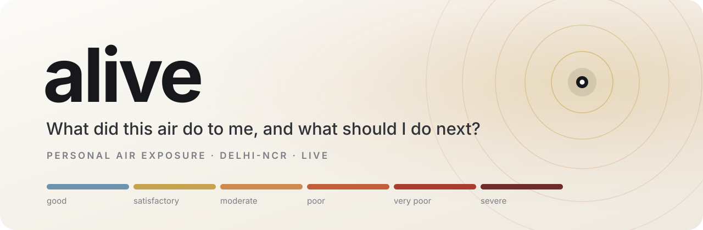

<br>

**Live, street-level air for the exact spot you're standing on in Delhi-NCR.<br>Routes priced in smoke, petrol and minutes. Real GPS navigation. No login.**

<br>

[](https://delhi-is-alive.vercel.app)


**[Open the live app](https://delhi-is-alive.vercel.app)** &nbsp;·&nbsp; [Architecture](#architecture) &nbsp;·&nbsp; [The air field](#the-air-field) &nbsp;·&nbsp; [Route modes](#three-ways-to-go) &nbsp;·&nbsp; [AWS](#how-alive-uses-aws) &nbsp;·&nbsp; [Run it](#run-it-locally)

</div>

<br>

<table>
  <tr>
    <td align="center" width="33%">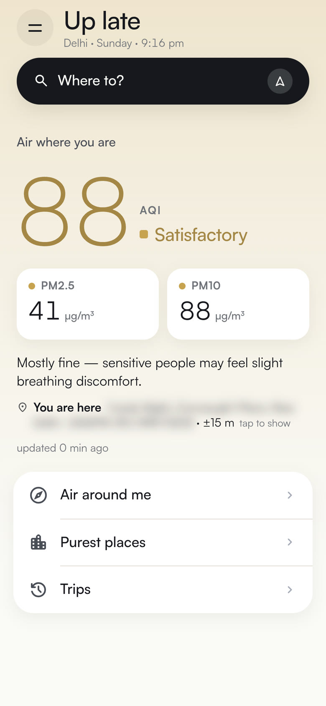<br><sub><b>Air where you stand</b><br>AQI, PM2.5 and PM10 for your exact point</sub></td>
    <td align="center" width="33%">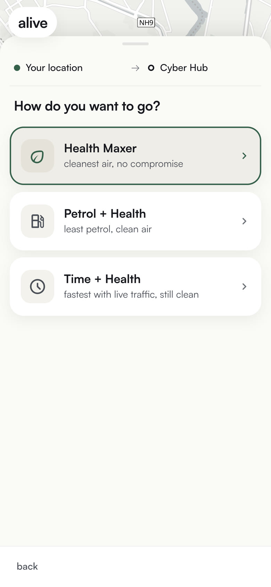<br><sub><b>Three ways to go</b><br>Health Maxer · Petrol + Health · Time + Health</sub></td>
    <td align="center" width="33%">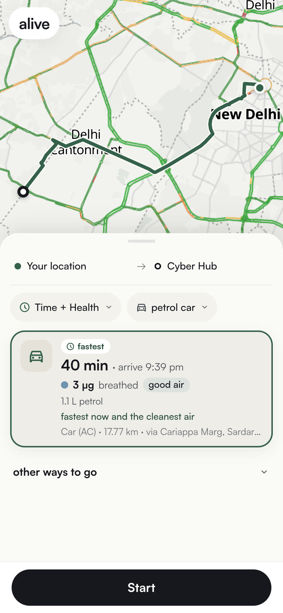<br><sub><b>Every route, priced honestly</b><br>live ETA · µg breathed · litres of petrol</sub></td>
  </tr>
  <tr>
    <td align="center">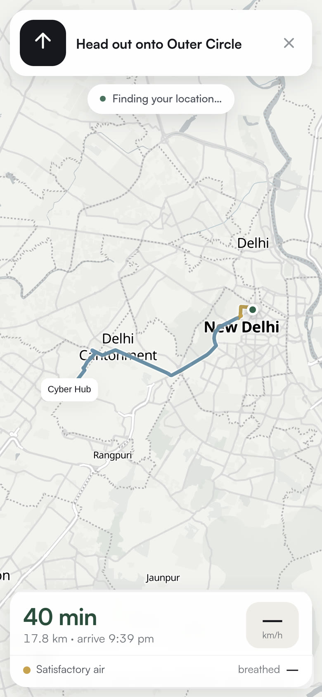<br><sub><b>Real GPS navigation</b><br>turns, reroutes, a receipt at the end</sub></td>
    <td align="center">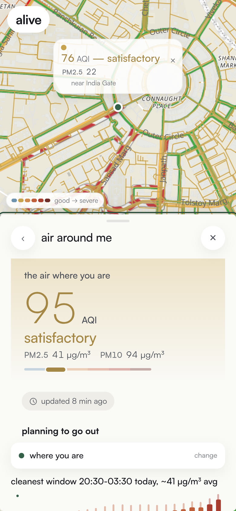<br><sub><b>Air Around Me</b><br>streets coloured by live air, tap anywhere</sub></td>
    <td align="center">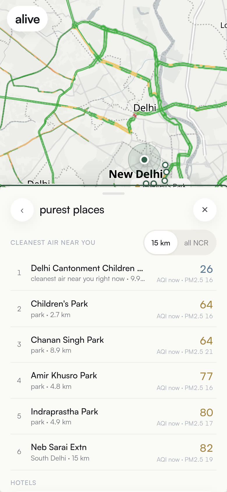<br><sub><b>Purest places</b><br>the cleanest named spots near you, and any hotel's air</sub></td>
  </tr>
</table>

<br>

## Why

Delhi's AQI is a city number. It's on the news, it's on every weather app, and it tells you nothing about **you**: what you breathed on the way to work, whether the other road was cleaner, or whether 7 am or 4 pm is the better hour for a walk.

Nobody can choose Delhi's air. But everyone chooses a road, a time and a place, every day. ALive turns the live air over Delhi-NCR into those choices, for one person, at one point, right now.

## What it does

| | |
|---|---|
| **Air where you stand** | AQI, PM2.5 and PM10 at your exact point, in CPCB bands, with how old the reading is. Your address and DIGIPIN stay blurred until you tap them. |
| **Where To** | One From/To box. Suggestions appear while you type, from a 240,000-place Delhi index plus Ola Maps and Mappls, deep enough for a bakery in a lane or a house number. |
| **Three ways to go** | Health Maxer, Petrol + Health, Time + Health. Each card shows the live ETA, micrograms you'll breathe, litres of petrol and the jam delay. |
| **Live journey** | Real GPS through `watchPosition`. If you stop, it stops. Off the line for more than 10 seconds, it reroutes. The receipt shows your intake, where you got stuck and the smokiest stretch. |
| **Air Around Me** | A detailed map with every street coloured by the live field. Tap any point for its AQI and the best time of day to be out there. |
| **Purest places and stays** | The cleanest named places near you or across NCR. Search any hotel for its air now and its best and worst hours. |
| **Operator dashboard** | Users, journeys, modes, vehicles, smoke avoided and route concentration. Anonymous counts only. |

## Architecture

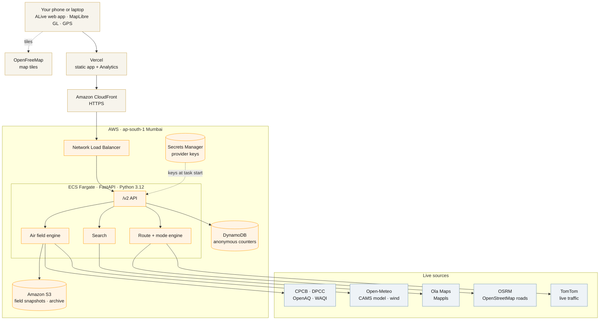

The browser talks to one origin. Vercel serves the app's files and forwards every API path to CloudFront, which sits in front of a Network Load Balancer and the Fargate tasks. Map tiles come straight from OpenFreeMap. Provider keys never reach the browser: the API calls Ola Maps, Mappls and TomTom on the app's behalf, with per-provider daily budgets and caching.

## How a trip gets planned

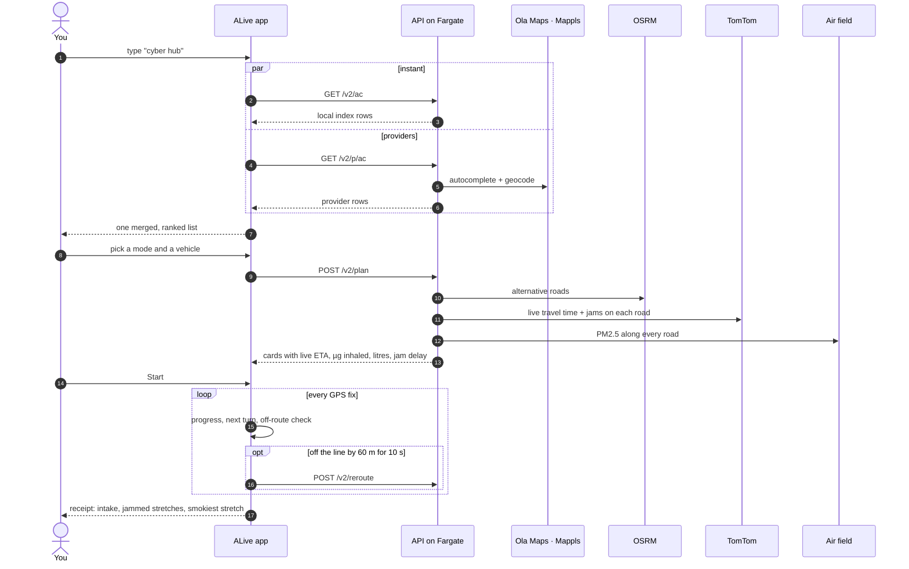

## The air field

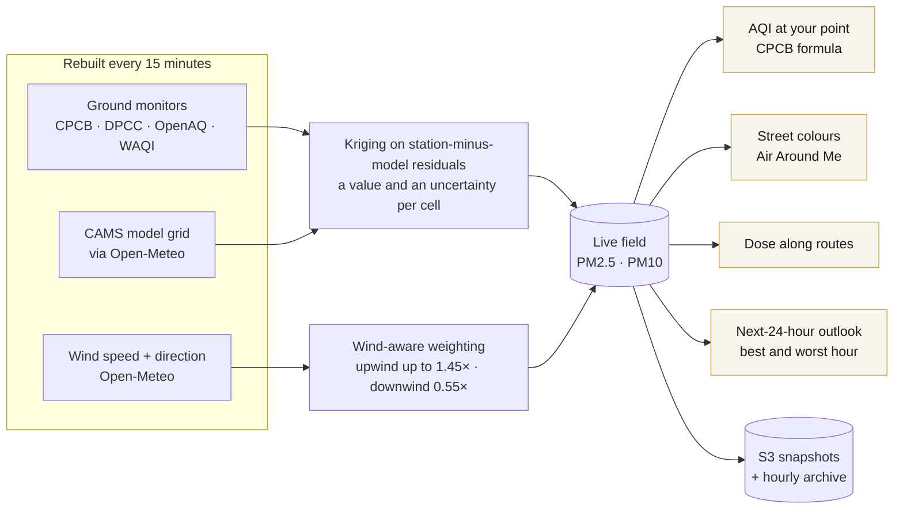

- **Ground truth beats the model.** Monitor readings from CPCB, DPCC, OpenAQ and WAQI are weighted above the CAMS background grid.
- **Smoke moves with the wind.** A monitor upwind of you counts for more than one downwind, scaled by wind speed. In calm air the weighting is even.
- **Uncertainty is kept, not hidden.** Kriging gives every cell a value and a spread, and the spread travels downstream as the dose band.
- **One field, one scale.** Home, Air Around Me, routes and the planning card all read the same field and the same CPCB AQI scale.

## Three ways to go

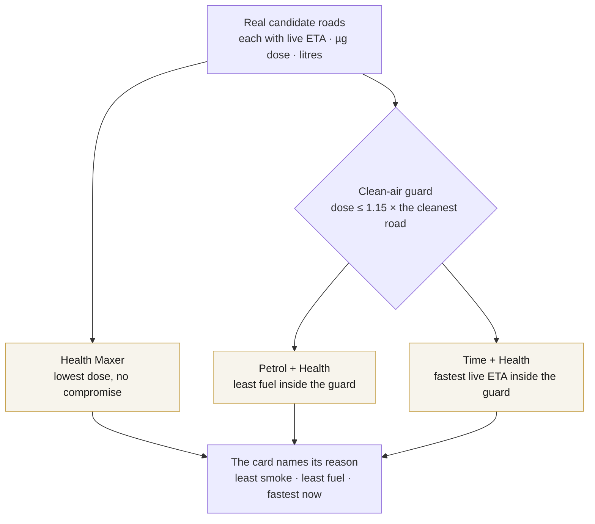

| Number on the card | Where it comes from |
|---|---|
| **µg breathed** | PM2.5 sampled along each segment × minutes on it × minute ventilation for that way of travelling, adjusted for the vehicle's micro-environment |
| **Litres** | Vehicle class and fuel, the road's speeds, and idling in jams. No prices, only fuel. |
| **Live ETA** | TomTom's live travel time on that exact road, with Ola Maps as a fallback. The same road shows the same time in every mode. |
| **Jam delay** | Live time minus free-flow time, with the jammed sections drawn on the map |

If one road is the cleanest, the fastest and the lightest on fuel, all three modes pick it and say so. ALive never invents a difference to make the modes look distinct.

## Search

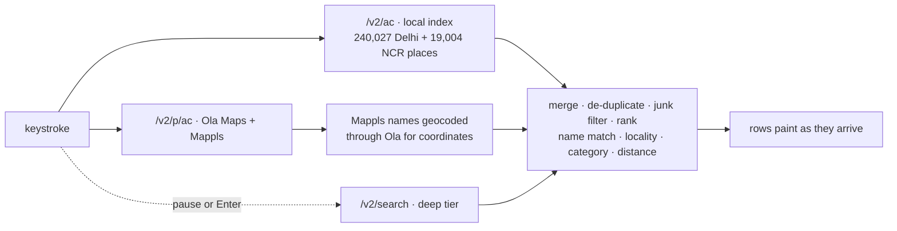

The local index answers first, so the list is never blank while you type. Provider rows join as they land. Ranking follows general rules: exact name, the locality you typed, the kind of place, and distance. Index rows with a far-away city's name at a Delhi point, like a "Hotel Shimla" pinned on Lodhi Road, are filtered out by those rules too.

## Tech stack

| Layer | Built with |
|---|---|
| **Web app** | Vanilla JavaScript, HTML, CSS · MapLibre GL JS 4.7 · OpenFreeMap Positron basemap · Vercel Analytics |
| **API** | Python 3.12 · FastAPI · Uvicorn · httpx · NumPy · H3 · boto3 |
| **Native core** | `alive_core` in C++ via pybind11: search index, dose and emission kernels, with a pure-Python reference fallback |
| **Routing** | OSRM on OpenStreetMap roads · TomTom live traffic · Ola Maps fallback |
| **Places** | 240,027-place Delhi gazetteer · 19,004 NCR places from GeoNames · Ola Maps · Mappls |
| **Air** | CPCB · DPCC · OpenAQ · WAQI · CAMS via Open-Meteo · Open-Meteo wind |
| **Location codes** | India Post DIGIPIN, computed on the device |
| **Cloud** | ECS Fargate · Network Load Balancer · CloudFront · CodeBuild · ECR · S3 · DynamoDB · Secrets Manager |

## How ALive uses AWS

Everything runs in **ap-south-1 (Mumbai)**.

| Service | What it does in ALive |
|---|---|
| **ECS Fargate** | Runs the FastAPI container: the API, the air field engine, search and the route engine. No servers to manage. |
| **Network Load Balancer** | Fronts the Fargate tasks |
| **CloudFront** | HTTPS and cache rules in front of the API. Vercel forwards every API path here. |
| **CodeBuild** | Builds the Docker image from `server/` on every deploy |
| **ECR** | Stores the images, tagged by commit SHA |
| **Secrets Manager** | Ola Maps, Mappls, TomTom, OpenAQ and WAQI keys plus the operator token, injected when a task starts |
| **S3** | Air field snapshots and the hourly archive |
| **DynamoDB** | The anonymous counters behind the operator dashboard |

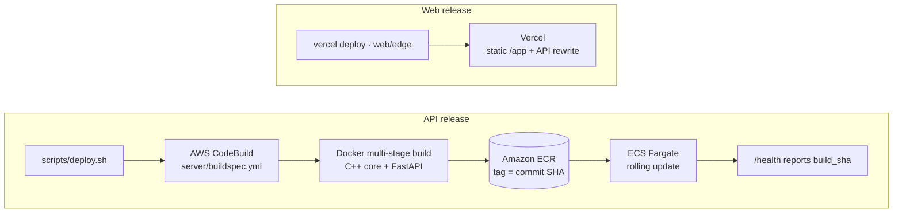

## Privacy

| Stays on your phone | Sent only with the request that needs it | Counted anonymously |
|---|---|---|
| Name, saved places, trips and receipts, settings | The point you ask about: to read its air, name its street, find places, or plan a route | Journeys, modes, vehicles, micrograms avoided, age group, area |

- No login and no account. Profile and trips live in the browser's local storage, and "Delete my data" clears them.
- Telemetry is batched and rate-limited, and never carries names, coordinates, addresses, PINs or links.
- The exact address and DIGIPIN on Home are blurred until you tap them, so a shared screen doesn't give away where you are.

## Honest by design

- Every number on screen traces back to a monitor, a route, a traffic reading or a calculation on those.
- A missing value is said out loud ("no live traffic reading", "thin read") and never filled with a zero.
- Freshness comes from the reading's own timestamp: "updated 3 min ago".
- If a route starts or ends away from the point you picked, the card says by how much.
- Without WebGL the map shows a plain note instead of a blank box.

## API

| Endpoint | What it returns |
|---|---|
| `GET /health` | Running `build_sha`, field age, per-source status |
| `GET /aqi?lat=&lon=` | PM2.5, PM10 and AQI at a point |
| `GET /v2/ac` | Instant suggestions from the local index |
| `GET /v2/p/ac` | Suggestions from Ola Maps and Mappls |
| `GET /v2/p/reverse` | Street address for a point |
| `POST /v2/plan` | Routes for a mode and a vehicle: live ETA, dose, fuel, jams |
| `POST /v2/reroute` | A fresh route when you leave the line |
| `GET /v2/strip` | The field sampled along a route |
| `GET /v2/day` | Best and worst hours for a point |
| `GET /v2/purest` | The cleanest named places nearby |
| `GET /v2/stays` | Hotels with their air |
| `POST /v2/tally` | Anonymous counters |

## Run it locally

```bash
git clone https://github.com/GC-WORK11/ALive.git
cd ALive/server
python3.12 -m venv .venv && source .venv/bin/activate
pip install -r requirements.txt
cp .env.example .env            # every key is optional
uvicorn main:app --port 8080    # then open http://localhost:8080/app/
```

Without `OLA_API_KEY`, `MAPPLS_API_KEY` and `TOMTOM_API_KEY`, search runs on the local index and routes run without live traffic, and the app says so on every card. Tests: `PYTHONPATH=. python -m pytest -q tests`.

<details>
<summary><b>Repository layout</b></summary>

```text
server/          FastAPI app: air field, ingest, routing, exposure, emissions
  webapp/        the web app (vanilla JS + MapLibre)
  v2/            search, providers, plan, modes, trip, city, explore
  core/          alive_core C++ (pybind11): search index, dose kernels
  data/          Delhi gazetteer, NCR places, aliases
  tests/         pytest suite
web/edge/        Vercel config: static app + API rewrite to CloudFront
infra/           provisioning, schedules, CloudWatch dashboard
scripts/         deploy and smoke checks
Mobile/          the earlier Expo (React Native) app
docs/            design notes and reports
```

</details>

## Known limits

- Search can still rank two places with the same name in the wrong order.
- Outside monitor coverage the app marks a reading as thin rather than guess.
- Real-road navigation needs far more kilometres of testing than a hackathon allows.

## Credits

Air data from **CPCB** and **DPCC**, **OpenAQ**, **WAQI**, and **Copernicus CAMS** via **Open-Meteo**. Places, routes and traffic from **Ola Maps**, **Mappls**, **TomTom** and **OSRM**. Map data © **OpenStreetMap** contributors, tiles by **OpenFreeMap**. NCR places from **GeoNames** (CC BY 4.0). Location codes by **India Post DIGIPIN**.

Built for the **AWS × WeMakeDevs Environmental Hacks 2026**. Released under the [MIT License](LICENSE).
